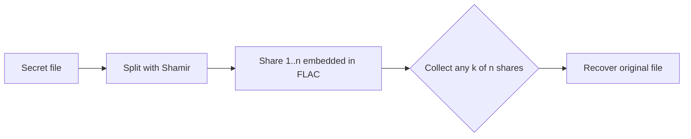

# stegshare

stegshare hides a file inside FLAC audio and splits it into Shamir shares. Recover the original file by combining any valid `k` shares from `n` generated FLAC carriers.

## Features

- hide a file in FLAC audio samples using LSB steganography
- split the secret with Shamir secret sharing (`k-of-n`)
- generate share files named from the original FLAC carrier names
- use via CLI or Python API

## Quick start

```bash
uv sync
stegshare split \
  -s ./secret.txt \
  -w ./base_flacs \
  -o ./flac_shares \
  -k 2 \
  -n 4

stegshare combine \
  -i ./flac_shares/01_share1.flac \
     ./flac_shares/023_share2.flac \
  -o ./recovered.txt
```

Example carrier directory:

```text
base_flacs/
  01.flac
  023.flac
  031.flac
  056.flac
```

Generated shares:

```text
flac_shares/
  01_share1.flac
  023_share2.flac
  031_share3.flac
  056_share4.flac
```

## Python API

```python
from stegshare import split_file_completely_into_flac, combine_flac_into_file

split_file_completely_into_flac(
    secret_file="./secret.txt",
    base_flac_dir="./base_flacs",
    output_dir="./flac_shares",
    k=2,
    n=4,
)

combine_flac_into_file(
    chosen_flac_paths=[
        "./flac_shares/01_share1.flac",
        "./flac_shares/023_share2.flac",
    ],
    recovered_file="./recovered.txt",
)
```

## Usage image / slide

```text
+------------------+      +-------------------------------+
| Secret file      | ---> | stegshare split              |
+------------------+      |   - select n FLAC carriers   |
                           |   - split with Shamir        |
                           |   - embed shares in LSB      |
                           +---------------+-------------+
                                           |
                                           v
                    +---------------------------+
                    | 01_share1.flac            |
                    | 023_share2.flac           |
                    | 031_share3.flac           |
                    | 056_share4.flac           |
                    +---------------------------+
                                           |
                     need only k of n shares
                                           |
                                           v
                           +----------------------+
                           | stegshare combine    |
                           +----------------------+
                                           |
                                           v
                           +----------------------+
                           | recovered.txt        |
                           +----------------------+
```



## Notes

- `k` must be `<= n`
- the source FLAC directory must contain at least `n` files
- output shares use the selected carrier base name, such as `01.flac -> 01_share1.flac`
- FLAC capacity must be large enough for the hidden payload

## Installation

```bash
python -m venv .venv
source .venv/bin/activate
pip install -e .
```

Or with uv:

```bash
git clone <repository-url>
cd stegshare
uv sync
```

## Dependencies

- `numpy`
- `soundfile`
- `pycryptodome`
