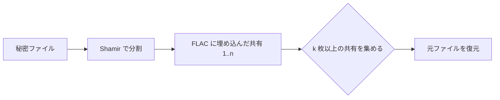

# stegshare

stegshare は、FLAC 音声ファイルにファイルを埋め込み、Shamir の秘密分散で `k-of-n` の共有に分割します。`n` 枚の共有のうち、任意の `k` 枚を揃えれば元ファイルを復元できます。

## 特徴

- FLAC の LSB に秘密ファイルを埋め込む
- Shamir の秘密分散で分割する (`k-of-n`)
- 選択した FLAC の元ファイル名をベースに共有ファイル名を作る
- CLI と Python API の両方に対応

## クイックスタート

```bash
uv sync
stegshare split \
  -s ./secret.txt \
  -w ./base_flacs \
  -o ./flac_shares \
  -k 2 \
  -n 4

stegshare combine \
  -i ./flac_shares/01_share1.flac \
     ./flac_shares/023_share2.flac \
  -o ./recovered.txt
```

元 FLAC の例:

```text
base_flacs/
  01.flac
  023.flac
  031.flac
  056.flac
```

生成される共有ファイル:

```text
flac_shares/
  01_share1.flac
  023_share2.flac
  031_share3.flac
  056_share4.flac
```

## Python API

```python
from stegshare import split_file_completely_into_flac, combine_flac_into_file

split_file_completely_into_flac(
    secret_file="./secret.txt",
    base_flac_dir="./base_flacs",
    output_dir="./flac_shares",
    k=2,
    n=4,
)

combine_flac_into_file(
    chosen_flac_paths=[
        "./flac_shares/01_share1.flac",
        "./flac_shares/023_share2.flac",
    ],
    recovered_file="./recovered.txt",
)
```

## 利用イメージ / スライド

```text
+------------------+      +-------------------------------+
| 秘密ファイル     | ---> | stegshare split              |
+------------------+      |   - n 本の FLAC を選択      |
                           |   - Shamir で分割          |
                           |   - LSB に埋め込み        |
                           +---------------+-------------+
                                           |
                                           v
                    +---------------------------+
                    | 01_share1.flac            |
                    | 023_share2.flac           |
                    | 031_share3.flac           |
                    | 056_share4.flac           |
                    +---------------------------+
                                           |
                     k 枚以上の共有があれば OK
                                           |
                                           v
                           +----------------------+
                           | stegshare combine    |
                           +----------------------+
                                           |
                                           v
                           +----------------------+
                           | recovered.txt        |
                           +----------------------+
```



## 注意事項

- `k` は `n` 以下である必要があります
- 元 FLAC ディレクトリには少なくとも `n` 枚の FLAC が必要です
- 出力ファイル名は `01.flac -> 01_share1.flac` のように元のキャリア名を使います
- 埋め込むデータに対して FLAC の容量が足りない場合があります

## インストール

```bash
python -m venv .venv
source .venv/bin/activate
pip install -e .
```

または uv:

```bash
git clone <repository-url>
cd stegshare
uv sync
```

## 依存ライブラリ

- `numpy`
- `soundfile`
- `pycryptodome`
